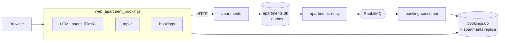
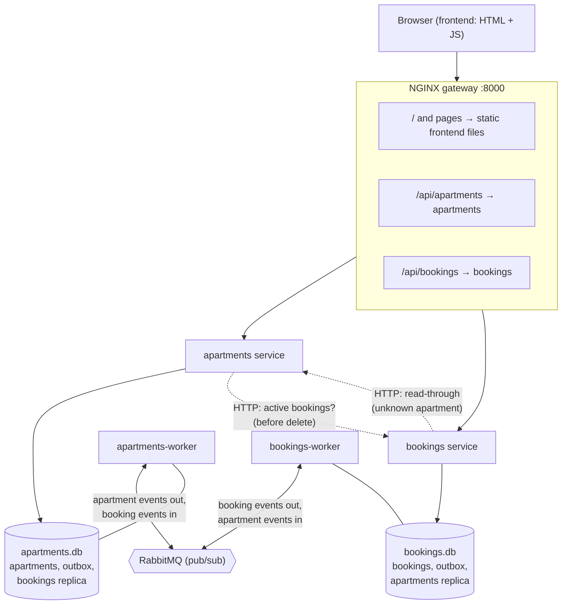
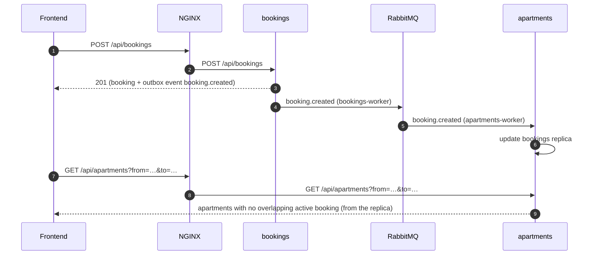
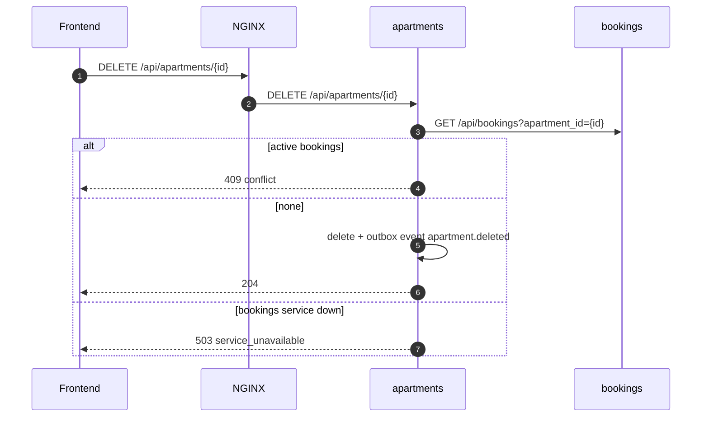

# Plan: NGINX gateway, static frontend and two equal services

Status: **in progress**: steps 1–3 done. Follows [microservices-plan.md](microservices-plan.md), which split apartments into their own service.

## Why

The target is the architecture from the course whiteboard sketch:

1. a **frontend** (the UI) of its own
2. a **gateway** (NGINX) that routes each request by its path to the right service
3. **services with their own databases** (apartments and bookings) that talk to each other through **pub/sub**

The app already has (3) partly: own databases, and events from apartments to bookings. It doesn't have (1) or (2) yet. The Python `web` app is the gateway, renders the UI on the server and runs the booking service, all at once. This plan separates those roles.

## Decisions

| Topic | Decision |
|---|---|
| Gateway | **NGINX**, the only published port (`127.0.0.1:8000`). It routes by path and adds no business logic. |
| Frontend | **Static HTML, CSS and JavaScript** served by NGINX. Pages load and change data only through the public REST API. Plain JavaScript, no framework and no build step. Page URLs stay the same. |
| Services | **apartments** and **bookings** are equal, each with its own SQLite database, each reachable only through the gateway. |
| Pub/sub | **Both directions.** Apartments publish apartment events (as today). Bookings publish booking events (new). Each service keeps a local copy (replica) of the other's data it needs. |
| Availability search | Moves to the **apartments service**, answered from its replica of active bookings. Public API unchanged. |
| "Can't delete an apartment with active bookings" | The apartments service **asks the booking service over HTTP** before deleting, so the rule stays strict. `503` if the booking service is down. |
| "Apartment must exist to be booked" | Stays in the booking service, using its apartments replica with an HTTP read-through (as today). |
| Public API | **Unchanged** (`openapi.yaml`), so the black-box `api_tests/` suite keeps working as the safety net. |

## Architecture

### Today

### Target

Containers: `nginx`, `apartments`, `apartments-worker`, `bookings`, `bookings-worker`, `rabbitmq`. Each worker runs its service's outbox relay and its event consumer in one process. Today these are two separate containers, which would grow to four.

### Gateway routes

| Path | Goes to |
|---|---|
| `/`, `/apartments/{id}`, `/bookings`, `/bookings/{id}` | the matching static page; its JavaScript reads the ID from the URL |
| `/static/*`, `/api/docs`, `/api/openapi.yaml` | static files |
| `/api/apartments`, `/api/apartments/*` | apartments service |
| `/api/bookings`, `/api/bookings/*` | bookings service |
| `/api/health` | answered by NGINX itself |
| any other `/api/*` | JSON `404 not_found`, answered by NGINX |
| a service that doesn't answer | JSON `503 service_unavailable` instead of NGINX's HTML `502` |

The last two rows keep the API's single error shape.

### Flow: availability search

### Flow: delete an apartment

## New events

Same envelope and delivery rules as the apartment events (at least once, skip `event_id`s already processed, apply only newer versions). Published to a new topic exchange `bookings`.

| Type | `data` |
|---|---|
| `booking.created` | booking (`id`, `apartment_id`, `check_in`, `check_out`, `status`) + `version` |
| `booking.changed` | same |
| `booking.cancelled` | same, with `status: cancelled` |

Bookings get a `version` column, bumped on every change, like apartments have.

## Consistency trade-offs

- **Search lags slightly behind bookings.** A booking made a moment ago may not yet hide its apartment in search. Today search reads the bookings directly, so this is new. Creating overlapping bookings is still impossible, because the booking service checks overlaps in its own database.
- **Delete race (as today).** A booking can be created between the delete check and the delete.
- **Calls in both directions.** Apartments calls bookings (delete check), and bookings calls apartments (read-through). Neither call is needed for reads or searches, so one service being down only affects writes that need the other.
- **The frontend depends on the API.** Every page loads through the gateway, so the UI shows the same `503` cases as the API.

## Steps

The HTTP API tests (`api_tests/`) must pass **unchanged** after every step: in CI against the Compose stack through NGINX, and locally against a small Python router that mimics the NGINX routes.

0. **This document.**
1. **NGINX in front of today's app,** with no behaviour change (done):
   - an `nginx` container, which becomes the only published port; `web` is unpublished
   - `ProxyFix`, so Flask sees the real client address
   - JSON `404` and `503` error responses
   - CI runs everything through NGINX
2. **Booking events** (done):
   - bookings get a `version`, an outbox and a relay
   - the apartments side gets a bookings replica and a consumer
   - relay and consumer are merged into one worker per service
3. **Apartments service owns search and the delete check** (done):
   - NGINX routes `/api/apartments` straight to it
   - the booking service drops its apartment routes
4. **Static frontend:**
   - rewrite the 4 pages and the API docs page as static files served by NGINX
   - remove the Flask templates and page routes
   - rework the Playwright tests
5. **Cleanup:**
   - rename `apartment_booking/` to `bookings_service/`
   - the CLI calls the API through the gateway
   - remove the in-process mode
   - update README, diagrams and both CI pipelines

## Verification (each step)

- `api_tests/` unchanged: locally through the Python router, and in CI against `docker compose` through NGINX
- unit tests and coverage at 90% or higher
- Playwright browser tests (reworked in step 4)
- `scripts/smoke_test.py` against Compose
- Compose CI checks: event delivery in both directions, `503` when either service is down, and the parts that keep working meanwhile
- GitHub Actions green on a pull request, plus a GitLab pipeline run
