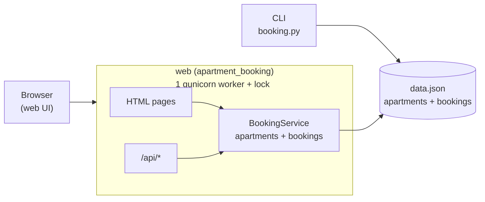
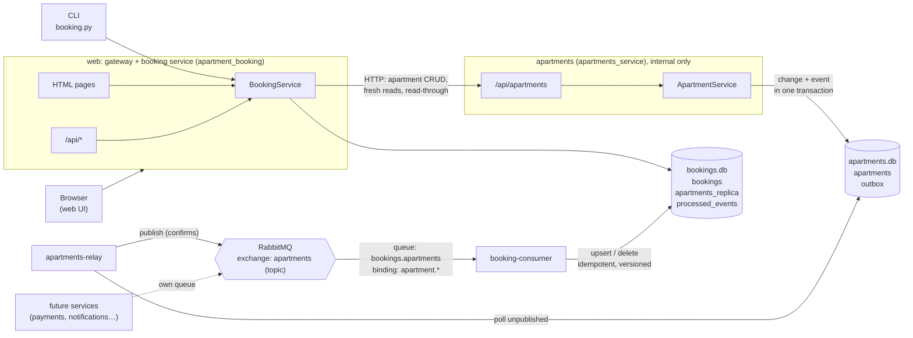
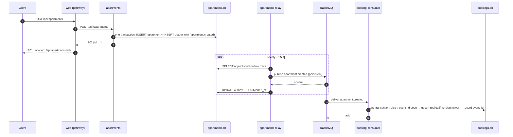
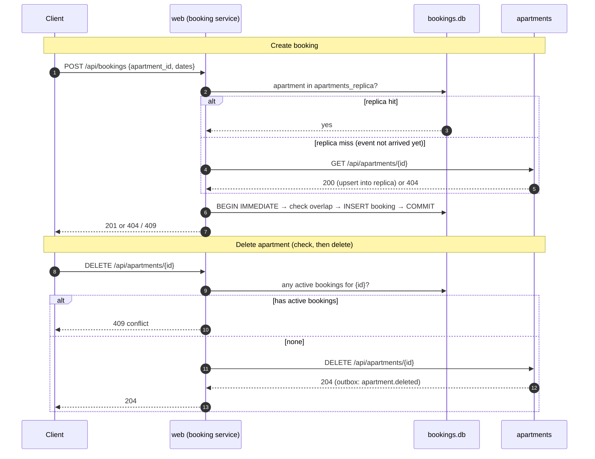

# Plan: extracting the Apartments microservice

Status: **in progress**: steps 0–4 done. Work happens on the `microservices-apartments` branch, one commit per step.

## Why

The app is currently a single Flask process with one `data.json` file. Every service call loads the whole file, changes it and writes it back. That has two consequences:

- Apartments and bookings can't be split apart, because one call reads and writes both at once.
- The server is stuck at **one gunicorn worker**, because concurrent writers would overwrite each other's changes. The CLI container shares the same file, so that can already happen today.

The goal is to make apartments a separate service that owns its own data, and to set up communication between services so that later services (payments, notifications and so on) can be extracted the same way.

## Decisions

| Topic | Decision |
|---|---|
| Data | Each service gets its **own SQLite database**. No shared database, and no foreign keys across services. |
| Commands and fresh reads | **HTTP** between services (stdlib `urllib`). |
| Change notifications | **Domain events over RabbitMQ**, written through a **transactional outbox** so a change and its event can't disagree. |
| Booking rules that need apartment data | Read a **local replica** of apartments kept up to date by events, with an HTTP read-through on a miss. |
| "Can't delete an apartment with active bookings" | **Check, then delete**: the booking side checks first, then calls the apartments service. There is a small race window, which we accept. |
| Public API | Unchanged. The existing app becomes the gateway, so `openapi.yaml`, the UI, the CLI and the tests keep working. The only addition is a `503 service_unavailable` response. |

## Architecture

### Today

### Target

Containers in `compose.yaml`: `web`, `booking-consumer`, `apartments`, `apartments-relay`, `rabbitmq`, plus the `booking` CLI profile. They all use the same image with different commands. There are two volumes, `booking-data` and `apartments-data`.

### Flow: an apartment change reaches the booking service

### Flow: create a booking, delete an apartment

## Events

The envelope is `{event_id (uuid4), type, occurred_at, data}`. The routing key equals `type`.

| Type | `data` |
|---|---|
| `apartment.created` | full apartment + `version` |
| `apartment.updated` | full apartment + `version` |
| `apartment.deleted` | `{id, version}` |

- **Delivery is at least once**: the relay can publish the same event twice.
- **The consumer is idempotent**: it skips any `event_id` it already recorded in `processed_events`.
- **Out-of-order safe**: the replica row changes only if the incoming `version` is higher than the stored one.

## Consistency trade-offs (accepted)

- **The replica lags slightly behind.** Availability search can miss an apartment created a moment ago. Booking creation doesn't have this problem, because it does an HTTP read-through on a replica miss.
- **Delete race.** A booking can be created for an apartment in the moment between its delete and the `apartment.deleted` event reaching the replica.
- **Apartments service down.** Booking create/change and search keep working from the replica. Apartment CRUD and apartment pages return `503 service_unavailable`.

## Steps

0. **This document** (plan + diagrams).
1. **Black-box HTTP API test suite** (`api_tests/`). It runs against the app over real HTTP, either in-process or at `API_BASE_URL` (the compose stack). It is written against today's monolith and must pass **unchanged** after every later step, so it acts as the safety net for the refactor.
2. **SQLite inside the monolith.** Separate `ApartmentRepo` and `BookingRepo`, a transactional overlap check, no more `SerializedService` (so more than one worker is allowed), and a `data.json` → SQLite migration command (`python -m apartment_booking.migrate`) that keeps IDs.
3. **Extract `apartments_service`** with an HTTP client in the booking service, shared HTTP helpers in `common/`, and `503` on outage. Compose already runs it as its own `apartments` container with its own volume.
4. **Events:** outbox, relay, RabbitMQ, consumer, replica. Compose already runs `rabbitmq`, `apartments-relay` and `booking-consumer`, and CI checks event delivery. Databases from before events are announced once by a snapshot when the relay first starts.
5. **Containers and CI:** compose services and volumes, coverage over all packages, compose checks for event propagation and outage behaviour. Mostly done along the way in steps 3–4, so each step ran in Docker and CI; what's left is confirming a green pipeline.

## Verification (each step)

- `python -m unittest discover -s api_tests -v`, in-process and with `API_BASE_URL` against `docker compose`, with no edits to test bodies
- unit tests, plus coverage at 90% or higher
- Playwright browser tests
- `scripts/smoke_test.py` against compose
- GitHub Actions and GitLab pipelines both green
